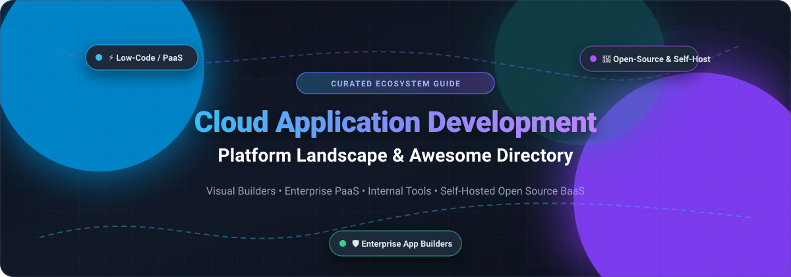

# Awesome Cloud Application Development Platform 

  

  
  
  
  
  
  
  

---

## 🌟 Top Cloud Application Development Platform Ecosystem

> **A curated directory of high-productivity Cloud Application Development Platforms, Low-Code / No-Code tools, Enterprise PaaS, and self-hosted Open-Source solutions.**

*Last updated: October 2026*

This directory tracks the most capable **cloud application platforms**, **internal tool builders**, and **self-hosted application frameworks**. Whether you are constructing enterprise CRUD apps, operational workflows, customer portals, or serverless micro-frontends, these solutions eliminate boilerplate by offering drag-and-drop UI composition, native database connectors, granular role-based access control (RBAC), and automated deployment pipelines.

---

## 📑 Table of Contents

- [📊 Sector Overview & Market Dynamics](#-sector-overview--market-dynamics)
- [🏢 SaaS/Hosted Platforms](#-saashosted-platforms)
- [🔓 Open-Source GitHub Projects](#-open-source-github-projects)
- [📈 Star History](#-star-history)
- [💖 Support](#-support)
- [🤝 How to Contribute](#-how-to-contribute)
- [⚠️ Disclaimer](#-disclaimer)

---

## 📊 Sector Overview & Market Dynamics

The global cloud application and low-code development platform market is estimated at approximately **$37 billion to $48 billion** (scaling towards $50B+ with a ~25–30% CAGR), driven by enterprise digital transformation, developer shortages, and agentic AI app generation. The market structure is **moderately concentrated**—anchored at the top tier by major software giants and enterprise suites (e.g., Microsoft Power Apps, Siemens Mendix, OutSystems, Appian), complemented by a diverse, fragmented ecosystem of developer-first builders, specialized database workflow tools, and open-source alternatives.

---

## 🏢 SaaS/Hosted Platforms

The following SaaS solutions are evaluated by scale, transparent pricing models, and specific free tier access limits, ordered by company valuation / revenue scale:

| Product | Description | Valuation / Revenue Scale | Pricing | Free Tier Limit |
| :--- | :--- | :--- | :--- | :--- |
| **[Microsoft Power Apps](https://powerapps.microsoft.com/)** | Microsoft's enterprise low-code platform deeply integrated into Microsoft 365, Power Platform, Azure, and Dataverse. | ~$3.9T Market Cap (Microsoft) | **$20/user/month** (Power Apps Premium for unlimited apps); or **$5/user/app/month** (Power Apps per-app subscription). | **No permanent production free tier**. Offers a 30-day free trial and a permanent **Developer Plan** strictly limited to 1 user for non-production development/learning. |
| **[Adobe App Builder](https://developer.adobe.com/app-builder/)** | Serverless extensibility framework for building custom cloud-native apps that extend Adobe Experience Platform, Commerce, and Workfront. | ~$105B Market Cap (Adobe) | **Pack-based annual licensing**; base deployments typically start at ~$15,000–$30,000/year (or bundled in qualifying Adobe Commerce/AEM cloud contracts). Standard Pack includes 6M GB-s compute, 24M events, 10TB CDN, 1TB file storage. | **No permanent free tier**. Enterprise trial sandbox access provided upon request via Adobe Developer Sales (strictly capped for non-production/staging: 200MB state storage, 0 PII data). |
| **[Mendix](https://www.mendix.com/)** | Enterprise-grade low-code application development platform designed for complex multi-experience enterprise applications. | ~$150B Market Cap (Parent Siemens AG / Acquired for $730M) | **Basic**: **€52.50/month** (~$57/month, up to 5 named users per app). **Standard**: starts at **€840/month** (~$915/month). | **Free Edition (Forever Free)**: 1 deployed cloud app, up to 0.5 GiB (512 MB) database storage, 1 GiB file storage; app sleeps after 1 hour of inactivity. |
| **[OutSystems](https://www.outsystems.com/)** | High-performance enterprise low-code development platform supporting mission-critical web and mobile systems. | ~$4.3B–$9.5B Valuation (~€500M+ ARR) | Starts at **$36,300/year** (billed annually, ~$3,025/month for entry-level enterprise deployment). | **Free Edition (Forever Free)**: 1 app environment (dev/test/prod combined), up to 100 end users, and 1 GB shared database storage. |
| **[Retool](https://retool.com/)** | Developer-centric visual development environment for building internal web apps, dashboards, and automated workflows. | ~$3.2B Valuation (~$120M ARR) | **Team**: **$10/builder/month + $5/end-user/month**. **Business**: **$50/builder/month + $15/end-user/month**. | **Free Plan (Forever Free)**: Up to 5 users, 500 workflow runs/month, 5 GB Retool Database storage, and 20 AI agent hours/month. |
| **[Appian](https://appian.com/)** | Enterprise low-code process automation platform combining workflow orchestration, data fabric, and AI-driven document processing. | ~$3.1B Market Cap (NASDAQ: APPN, ~$600M ARR) | Standard entry tiers start at **$75/user/month** (typically requires annual agreement with a 100-user baseline enterprise minimum). | **Community Edition (Forever Free)**: 1 dedicated developer environment, limited to 1 user for non-production prototyping and learning. |
| **[Quickbase (Pave)](https://www.quickbase.com/)** | No-code work management and operational application platform connecting operational data with business workflows. | ~$1.0B Valuation (~$215M ARR) | **Team Plan**: starts at **$35/user/month** (billed annually; subject to baseline platform contract minimums). | **Free Trial**: **30-day free trial** with access to Team features and up to 100 credits; no permanent free tier. |
| **[Caspio](https://www.caspio.com/)** | No-code relational database and business application builder with zero per-user licensing fees. | ~$120M Estimated Revenue | **Team Plan**: starts at **$300/month** (billed annually at $3,600/year, includes unlimited application users and 50,000 data records). | **Free Trial**: **14-day free trial** with full platform features and testing capacity; no permanent free tier. |

---

## 🔓 Open-Source GitHub Projects

Self-hosted open-source application platforms grant total infrastructure sovereignty, prevent per-seat SaaS lock-in, and allow unlimited custom coding.

The repositories below are ranked strictly by **GitHub Stargazer Count (Descending)**, with social badge links to each project's stargazers page:

- **[Supabase](https://github.com/supabase/supabase)**   
  ⚡ **The open-source Firebase alternative & enterprise backend application platform.** Provides a dedicated PostgreSQL database, built-in instant GraphQL & REST APIs, edge functions, real-time listeners, vector search (`pgvector`), and complete auth. Perfect as the rock-solid data and API engine backing bespoke frontend applications.

- **[NocoDB](https://github.com/nocodb/nocodb)**   
  📊 **The open-source Airtable alternative over existing relational databases.** Transforms PostgreSQL, MySQL, MariaDB, SQLite, and Microsoft SQL Server into smart, collaborative spreadsheet-database apps with kanban, gallery, grid, and form views, complete with automated REST APIs and webhook pipelines.

- **[PocketBase](https://github.com/pocketbase/pocketbase)**   
  🚀 **Self-contained, single-file open-source backend in Go.** Integrates an embedded SQLite database with real-time subscriptions, comprehensive auth (email/password, OAuth2), file asset storage (S3/local), and an instant admin UI dashboard.

- **[Appwrite](https://github.com/appwrite/appwrite)**   
  🛡️ **Complete secure end-to-end backend platform for web, mobile, and internal applications.** Features flexible user authentication, document databases, storage management, scheduled CRON functions, security rules, and SDKs across 10+ programming languages.

- **[ToolJet](https://github.com/ToolJet/ToolJet)**   
  🛠️ **Extensible open-source low-code internal tool builder with enterprise connectivity.** Connects seamlessly to PostgreSQL, MongoDB, Snowflake, Google Sheets, BigQuery, AWS S3, and OpenAPI-compliant REST/GraphQL APIs with 50+ rich UI widgets, JavaScript scripting, and fine-grained permissions.

- **[Appsmith](https://github.com/appsmithorg/appsmith)**   
  🖥️ **The leading open-source internal application and admin panel framework.** Create interactive admin dashboards, CRUD applications, and approval workflows by combining pre-made UI widgets with customized JavaScript and Git-backed version control.

- **[Directus](https://github.com/directus/directus)**   
  🧩 **Instant zero-code Data Studio and headless data engine for any SQL schema.** Layers dynamically on top of existing databases to generate realtime GraphQL/REST APIs, granular user permission schemas, and visual workflow builders without database migrations or vendor lock-in.

- **[Refine](https://github.com/refinedev/refine)**   
  💎 **React-based headless meta-framework for rapid enterprise internal tools and CRUD apps.** Decouples business logic from presentation, giving developers complete UI freedom with Ant Design, Material UI, Mantine, or Tailwind CSS while automating data routing, auth, and state.

- **[Budibase](https://github.com/Budibase/budibase)**   
  🏗️ **All-in-one low-code application builder with built-in database & automation engine.** Unifies internal database storage (CouchDB/external SQL), drag-and-drop form and portal creation, automated webhook workflows, and self-hosted Docker deployment.

- **[Windmill](https://github.com/windmill-labs/windmill)**   
  ⚙️ **Developer-first platform that turns Python, TypeScript, Go, Bash, or SQL scripts into production UIs & workflows.** Ideal for engineering teams that prefer writing code over purely visual builders to construct backend operations, cron schedules, and incident response tooling.

- **[ILLA Builder](https://github.com/illa-family/illa-builder)**   
  🤖 **AI-empowered open-source low-code platform for building internal applications.** Offers drag-and-drop UI composition, JavaScript/SQL integrations, and native support for LLM agents and multi-source event connections.

- **[Baserow](https://github.com/bram2w/baserow)**   
  📋 **Modular open-source no-code relational database builder.** Provides an Airtable-like spreadsheet interface capable of processing millions of rows, with infinite custom views, webhook events, and full REST API access.

- **[Lowcoder](https://github.com/lowcoder-org/lowcoder)**   
  🔌 **Open-source low-code rapid application development framework.** Provides modular widget plugin architectures, custom JavaScript execution environments, and direct connections to corporate databases and APIs.

---

## 📈 Star History

---

## 💖 Support

If you find this curated ecosystem guide valuable, please consider supporting the project:

- ⭐ **Star this repository** to help others discover it!
- 🍴 **Fork the repo** to contribute new platforms and keep pricing updated.
- 📢 **Share with your team** and fellow cloud platform engineers.
- ☕ **Buy me a coffee**: Support ongoing maintenance through the [GitHub Sponsors Dashboard](https://github.com/sponsors/ishandutta2007).

---

## 🤝 How to Contribute

Contributions are warmly welcomed! Help keep this list fresh, accurate, and comprehensive:

1. **Fork the repository** on GitHub.
2. **Add or update entries** in `README.md` following the standardized format (product name, official link, GitHub stargazer badge if open-source, and concise capabilities description).
3. **Ensure objective accuracy**: For SaaS listings, include specific entry pricing tiers and transparent free plan/trial limits.
4. **Submit a Pull Request** with a descriptive summary of your changes.

---

## ⚠️ Disclaimer

- This is an independent, **community-curated** directory and does not constitute an endorsement or commercial partnership.
- **Pricing models fluctuate**: SaaS vendors frequently revise subscription tiers, user seat thresholds, and API consumption formulas. Always consult official vendor pricing pages before making enterprise procurement commitments.
- **Free tiers are typically capped**: Production workloads frequently require upgrading to paid plans once data storage, API rate limits, or user counts exceed baseline tiers.
- **Open-source infrastructure costs**: While open-source software is free to license, running it in high-availability environments requires cloud compute, database hosting, operational monitoring, and backup infrastructure.

---

  <b>Built with ❤️ for DevOps engineers, internal tool builders, and cloud architects worldwide.</b>

